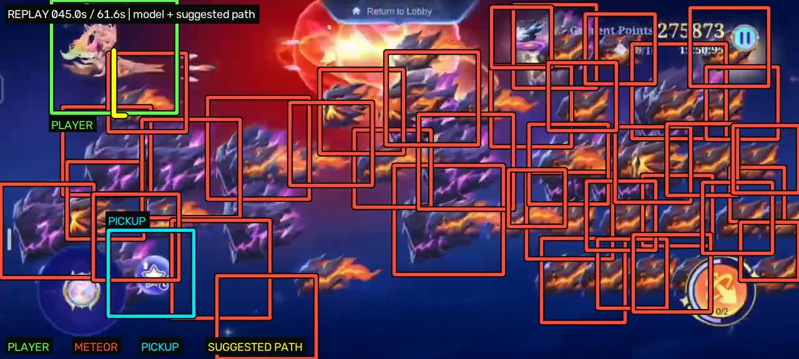

# Starfall Breakout: Computer Vision and ML Research

A Starfall Breakout research project with a trained object detector, tracking and planning experiments, offline training tools, and recorded-gameplay previews.

## Private model benchmark: 282,793 points

The **private, unreleased model and movement/control setup achieved 282,793 points**, according to the maintainer. This benchmark is shared to show what was possible with that private setup and provide a reference point for future ML experiments. The screenshot shows **rank #1 in the displayed weekly ranking list**, and the recording ends on the same highest-points total.


[](https://github.com/smsolutionsva-byte/mlbb-Starfall-ML-model/releases/download/demo-2026-10-24/starfall-282793-preview.mp4)

**[Watch / download the 61-second benchmark clip](https://github.com/smsolutionsva-byte/mlbb-Starfall-ML-model/releases/download/demo-2026-10-24/starfall-282793-preview.mp4)** · [Benchmark release and checksums](https://github.com/smsolutionsva-byte/mlbb-Starfall-ML-model/releases/tag/demo-2026-10-24) · [Benchmark details](docs/RESULTS.md)

**Public model:** the earlier YOLO26n object detector published before this benchmark update. It remains available as a base for further training and research. **Benchmark model:** the private, unreleased model and movement/control setup used for the reported 282,793-point run. For readability, the shared recording has a visualization layer added afterward using the public detector and planner preview.

## What is public and what stays private

| Component | Availability |
| --- | --- |
| Earlier public YOLO26n detector trained from 1,988 reviewed images | Included: player, meteor, and pickup classes; published before this benchmark update |
| Image testing, manual live observation, and recorded-video preview | Included, with CPU/OpenVINO support |
| Experimental baseline tracking, planning, movement-response code, and synthetic training utilities | Already present in this repository; experimental research components |
| Private, unreleased model and movement/control setup | Used for the maintainer-reported 282,793-point benchmark; additional trained artifacts remain private |

**Maintainer's note:** The 282,793-point run was achieved using my private, unreleased model and movement/control setup. I am sharing the score, recording, and redacted ranking as a benchmark to show what is possible. I am keeping the additional model and movement/control artifacts private to respect MLBB's guidelines and discourage automated farming. Use the earlier public model and research code as a base for your own ML experiments: improve the dataset, train further, evaluate on fresh recordings, or study tracking and decision-making offline.

MLBB's [Terms of Service](https://www.mobilelegends.com/news/articleldetail?newsid=2728920) restrict automated interaction and bots. The intended public use here is recording analysis and offline ML research. This project is not affiliated with or endorsed by Moonton.

## Preview the trained detector

1. Follow [the setup guide](docs/FRIEND_SETUP.md). The published checkpoint is already in `weights/starfall-detector-1988/`; additional private models are not required for observation.
2. Double-click **Test-Trained-Model.cmd** for an annotated screenshot, or drag your own screenshot onto it.
3. Drag an original phone recording onto **Preview-Recorded-Video.cmd**. It displays the analysis and saves an annotated MP4 under `reports/`, preserving the source timing, resolution, and audio. Press **q** to finish early.
4. For manual live observation, connect the calibrated phone, authorize USB debugging, and use **Preview-Trained-Model.cmd**. On a PC without NVIDIA graphics, use **Preview-Trained-Model-CPU.cmd**. You control the game during these previews.

The large square boxes use **green for the player, red for meteors, cyan for pickups**, and a **thick yellow suggested path**. Boxes have display padding and are not measured collision hitboxes. Recorded previews perform no training and send no phone input.

For command-line playback:

```powershell
.\.venv\Scripts\python.exe -m starfall.cli preview-video "your-recording.mp4"
```

The release video is the finished annotated output, rather than a raw training recording. For another experiment, use your own original recording. Full recordings and additional checkpoints stay outside Git; the demonstration video is hosted as a release asset.

## Train and evaluate as an ML project

The included detector recognizes **player, meteor, and pickup**. It is a perception model, not a complete movement or boss-strategy policy. See [its model card](weights/starfall-detector-1988/README.md) for the split, training settings, checksums, reported metrics, and evaluation limitations.

Useful research directions include fresh hand-labelled gameplay, capture-group-separated train/test splits, hard examples with overlapping meteors and ultimate effects, temporal tracking, and offline policy experiments. Keep recorded detections separate from human-reviewed ground truth.

The synthetic arena supports PPO/DQN and multiple parallel environments. It is an engineering sandbox with approximate physics and rewards, not a faithful offline copy of MLBB. Synthetic scores are not game points, and an offline training run does not establish improved live gameplay.

- [Training-laptop setup and offline experiments](docs/FRIEND_SETUP.md)
- [Research rationale and references](docs/RESEARCH.md)
- [Private model benchmark and media provenance](docs/RESULTS.md)
- [Earlier measurements and experiment history](reports/EVIDENCE.md)

## Verification

The preview update passed **54 software regression tests**. For the published demonstration, all **3,066 video frames** retained their original presentation times, and all **2,654 audio packets** were copied without changing their encoded bytes. These are media-integrity checks, not a detector-accuracy benchmark or a measurement of live reaction time.

```powershell
.\.venv\Scripts\python.exe -m pytest -q
```
